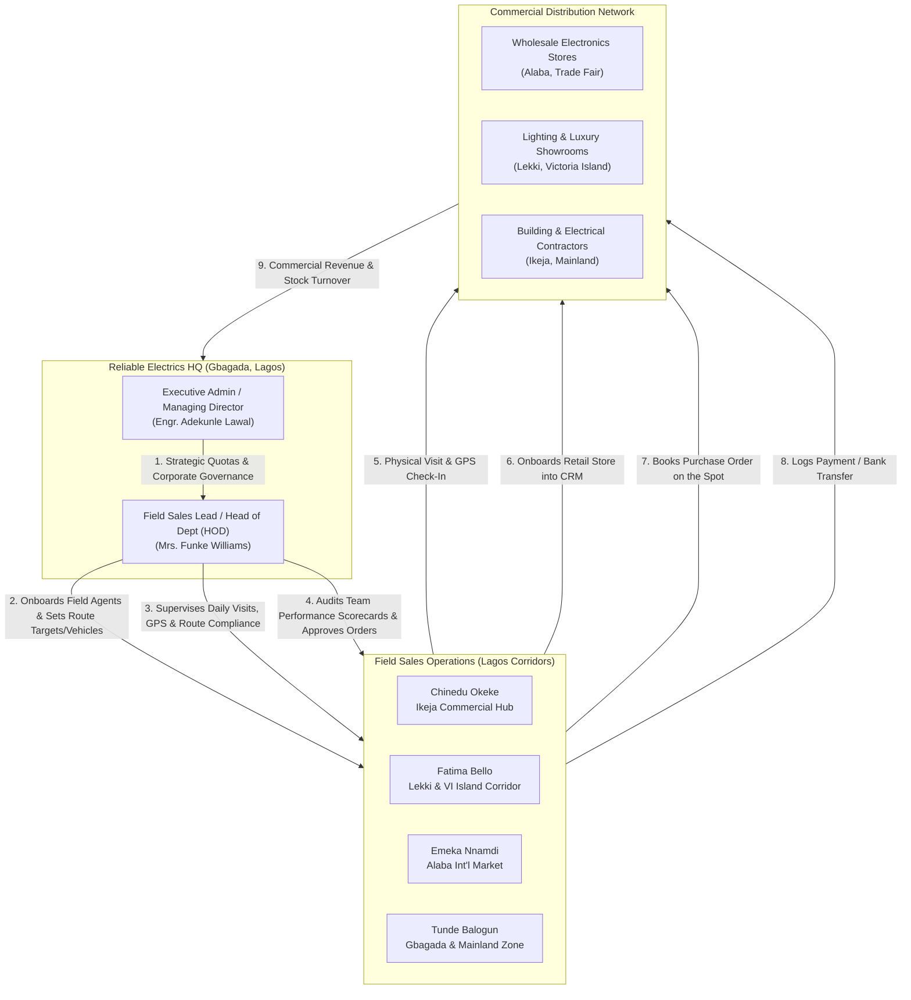

# Reliable Electrics Nigeria Limited — Enterprise CRM
## Stakeholder Role & Demo Execution Guide

> **Application Overview**: Enterprise Field Sales & Commercial Distribution CRM built for **Reliable Electrics Nigeria Limited** (Phase 1, 32B Oguntona Crescent, Gbagada, Lagos). The application manages field executive onboarding, retail customer onboarding by field agents, date-by-date daily activity auditing, wholesale product catalog, purchase orders, printable waybills, and payment collections.

---

## 1. Quick Access & Demo Credentials

| Parameter | Value |
| :--- | :--- |
| **Live Railway URL** | [https://crm-web-production-a3173e81.up.railway.app](https://crm-web-production-a3173e81.up.railway.app) |
| **Demo 1-Click Switcher** | Available directly at `/login` (no password typing required) |
| **Default Password** | `password` (for all seeded demo accounts) |

### Demo Accounts Directory

| Stakeholder / Persona | Name | Email | Code | Assigned Territory |
| :--- | :--- | :--- | :--- | :--- |
| **Executive Admin (MD)** | Engr. Adekunle Lawal | `admin@reliableelectrics.ng` | `HQ-ADM-01` | Headquarters — Lagos Operations |
| **Field Sales Lead (HOD)** | Mrs. Funke Williams | `lead@reliableelectrics.ng` | `REL-HOD-01` | Greater Lagos Commercial Operations |
| **Field Executive (Ikeja)** | Chinedu Okeke | `chinedu@reliableelectrics.ng` | `REL-FE-101` | Ikeja, Alausa & Oregun Hub |
| **Field Executive (Island)**| Fatima Bello | `fatima@reliableelectrics.ng` | `REL-FE-102` | Lekki Phase 1, VI & Ikoyi |
| **Field Executive (Alaba)** | Emeka Nnamdi | `emeka@reliableelectrics.ng` | `REL-FE-103` | Alaba Int'l & Trade Fair |
| **Field Executive (Mainland)**| Tunde Balogun | `tunde@reliableelectrics.ng` | `REL-FE-104` | Gbagada, Ogudu, Anthony & Shomolu |

---

## 2. Stakeholder Matrix & Responsibilities



---

## 3. Stakeholder 1: Executive Management / Admin

### Primary Persona
* **Name**: Engr. Adekunle Lawal
* **Role**: Managing Director & National Distribution Head
* **Email**: `admin@reliableelectrics.ng`
* **Access Level**: Full Administrative Rights (System-wide visibility)

### Core Objectives
1. Drive commercial distribution revenue across Lagos state commercial hubs.
2. Monitor real-time performance and quota pacing of field sales executives.
3. Audit daily field movements date-by-date to ensure field accountability.
4. Maintain credit risk governance on wholesale and retail distributor accounts.
5. Control inventory pricing (Wholesale vs Retail) and dispatch logistics.

### Step-by-Step Demo Actions for Admin

#### Action 1: Executive Dashboard Analysis
* **Route**: `/dashboard`
* **What to inspect**:
  - **KPI Cards**: Month-to-date sales revenue (₦), quota attainment percentage, total active field agents, registered commercial stores, and pending orders awaiting dispatch.
  - **Revenue Target Gauge**: Target vs Realized revenue bar with variance indicator.
  - **Territory Distribution Chart**: Breakdown of retail network density across Ikeja, Alaba, Lekki, and Mainland.
  - **Leaderboard**: Top-performing field executives ranked by revenue and store onboarding pace.
  - **Live Audit Stream**: Real-time log of customer visits, orders booked, and payments confirmed.

#### Action 2: Date-by-Date Field Activity Tracker
* **Route**: `/activities/daily`
* **What to inspect**:
  - Click on the **Date Picker** and select today's date or previous dates.
  - Notice the summary cards automatically recalculate for that specific date: total visits conducted, orders booked, payments collected, and new stores onboarded.
  - Review the **Agent Summary Table**: Shows what every individual agent did on that day.
  - Expand any agent card to see the detailed audit feed: exact time of check-in, customer visited, visit purpose, visit notes, and the clickable **GPS coordinates** (e.g. `6.5956, 3.3512`) that link directly to Google Maps for location verification.

#### Action 3: Field Executive Onboarding
* **Route**: `/agents/create`
* **How to demo**:
  1. Click **Field Agents** in the navigation, then click **+ Onboard Field Agent**.
  2. Complete the onboarding profile:
     - **Full Name**: e.g. `Bolanle Adeleke`
     - **Email**: `bolanle.adeleke@reliableelectrics.ng`
     - **Agent Code**: `REL-FE-105`
     - **Phone**: `+234 802 123 4567`
     - **Assigned Territory**: Select or enter `Ikorodu & Ketu Distribution Corridor`
     - **Assigned Vehicle / Transport Mode**: Select `Company Motorbike (Yamaha Crux)`
     - **Monthly Revenue Target (₦)**: `₦8,000,000`
     - **Daily Visit Target**: `7 visits/day`
     - **Monthly Customer Onboarding Target**: `15 stores/month`
     - **Status**: `Active`
  3. Click **Save & Onboard Agent**. The system creates the account, activates authentication, and redirects to the agent's live profile card showing their targets and metrics.

#### Action 4: Customer Directory & Onboarding Audit
* **Route**: `/customers`
* **What to inspect**:
  - View all commercial customers onboarded across Lagos.
  - Notice the **Onboarded Date** column and the **Onboarded By** column linking each store to the specific field executive who registered them.
  - Filter by Territory (e.g., Alaba, Lekki, Ikeja) or Business Category (Wholesaler, Retailer, Contractor).
  - Click into any customer (e.g., `Supreme Lighting Gallery Lekki`) to view credit terms, GPS coordinates, historical orders, and outstanding payment balances.

#### Action 5: Executive Activity Reporting & CSV Export
* **Route**: `/activities/report`
* **How to demo**:
  1. Filter activities by Agent (e.g. `Chinedu Okeke`), Activity Type (e.g., `Customer Onboarded` or `Order Placed`), and Date Range.
  2. Click **Filter Activities** to see filtered audit logs.
  3. Click **Export to CSV** — the system generates and downloads a clean spreadsheet containing timestamps, agent details, customer names, activity types, and notes for management reporting.

#### Action 6: Sales Orders & Printable Waybill Generation
* **Route**: `/orders`
* **How to demo**:
  1. View the complete order register with status badges (`Pending`, `Confirmed`, `Shipped`, `Delivered`).
  2. Click on order `REL-ORD-1001` to view order line items.
  3. Click **Print Waybill / Delivery Note** — opens a formatted, print-ready document with company letterhead (**Reliable Electrics Nigeria Limited, Phase 1, 32B Oguntona Crescent, Gbagada, Lagos**), customer delivery address, line item breakdown, warehouse dispatch officer signature line, and customer acceptance signature line.

#### Action 7: Wholesale & Retail Product Catalog
* **Route**: `/products`
* **What to inspect**:
  - Complete list of distributed items: Commercial Floodlights, 16-Way Distribution Boards, MCBs/MCCBs, Luxury LED Chandeliers, Modular Double Sockets, 2.5mm² Copper House Wiring Cable coils.
  - Price tiers: Standard Retail Unit Price vs Wholesale Distributor Price.
  - Stock levels and Minimum Order Quantities (MOQ).

---

## 4. Stakeholder 2: Field Sales Lead / Head of Department (HOD)

### Primary Persona
* **Name**: Mrs. Funke Williams
* **Role**: Head of Field Sales & Department Lead
* **Email**: `lead@reliableelectrics.ng`
* **Access Level**: Field Operations Management & Team Supervision

### Core Objectives
1. Supervise field sales executives across all Lagos commercial corridors (Ikeja, Alaba, Lekki, Mainland).
2. Onboard new field sales executives into the team, assigning territories, revenue quotas, visit targets, and company motorbikes/vehicles.
3. Monitor daily agent performance, visit logs, and GPS route compliance date-by-date.
4. Audit team performance scorecards, completion rates, and customer onboarding velocity.
5. Approve and dispatch field sales orders, monitor collections, and assist field agents with key accounts.

### Step-by-Step Demo Actions for Field Sales Lead (HOD)

#### Action 1: Team Leadership Dashboard
* **Route**: `/dashboard` (logged in as `Mrs. Funke Williams`)
* **What to inspect**:
  - Banner: *"Reliable Electrics Nigeria Limited • Department of Field Sales & Distribution"*.
  - Department field metrics: Active field reps, monthly new customer onboarding count, today's team visit total, month-to-date sales orders, and collections.
  - **Live Field Agent Leaderboard**: Real-time table displaying today's visit compliance vs daily target for each agent, monthly store onboards, and revenue attainment percentage.
  - Direct 1-click management shortcuts: **Date-by-Date Tracker**, **Onboard Agent**, and **Team Reports**.

#### Action 2: Onboard a New Field Sales Executive
* **Route**: `/agents/create`
* **How to demo**:
  1. Click **Onboard Agent** on the leadership dashboard or navigation menu.
  2. Enter new field executive details:
     - **Full Name**: e.g., `Babatunde Fashola`
     - **Corporate Email**: `babatunde.fashola@reliableelectrics.ng`
     - **Agent Code**: Auto-suggested (e.g., `REL-FE-105`)
     - **Mobile Phone**: `+234 803 777 6655`
     - **Assigned Territory**: `Ikorodu Commercial Belt & Hardware Markets`
     - **Assigned Vehicle**: `Company Motorbike (Bajaj Boxer)`
     - **Monthly Revenue Target**: `₦5,000,000`
     - **Daily Visit Target**: `7 visits/day`
     - **Monthly Onboard Target**: `15 stores`
     - **Onboarded Date**: Today's date
  3. Click **Complete Field Executive Onboarding**.
  4. Notice the system automatically records `Mrs. Funke Williams` as the onboarding supervisor, creates the credentials, and redirects to the agent's performance profile.

#### Action 3: Inspect Individual Field Agent Performance Drill-Down
* **Route**: `/agents/{agent}` (e.g. click on `Chinedu Okeke`)
* **What to inspect**:
  - Individual agent scorecard: Today's visits count, daily compliance %, monthly revenue vs target, and stores onboarded.
  - Recent GPS Check-in history with exact time and physical street address.
  - Full list of stores onboarded by this agent and their order history.
  - Click **Edit Profile** to update the agent's assigned territory, targets, or vehicle.

#### Action 4: Date-by-Date Field Activity Tracker
* **Route**: `/activities/daily`
* **What to inspect**:
  - Filter by date (Today, Yesterday, or any custom date).
  - Inspection cards for all field agents: see at a glance who met their daily visit quota.
  - Timeline of store visits, check-in timestamps, GPS coordinates, meeting notes, and payment collections.

#### Action 5: Team Performance Scorecards & CSV Audit
* **Route**: `/activities/report`
* **What to inspect**:
  - Performance Scorecards for all field agents: Visits count, stores onboarded, orders booked, total revenue, and collections within any chosen date range.
  - Click **Export CSV** to download the team performance audit for weekly management meetings.

#### Action 6: Approve Sales Orders & Monitor Field Collections
* **Route**: `/orders` & `/payments`
* **What to inspect**:
  - Review orders booked by field agents across Lagos stores.
  - Open any order (e.g. `ORD-2026-0083`) and click **Update Order Status** (Pending Approval &rarr; Approved &rarr; Dispatched).
  - Track real-time collections and bank transfer reference notes logged from the field.

---

## 5. Stakeholder 3: Field Sales Executives

### Primary Personas
* **Chinedu Okeke** (`chinedu@reliableelectrics.ng`) — Ikeja, Alausa & Oregun Commercial Hub
* **Fatima Bello** (`fatima@reliableelectrics.ng`) — Lekki Phase 1, Victoria Island & Ikoyi
* **Emeka Nnamdi** (`emeka@reliableelectrics.ng`) — Alaba International Market & Trade Fair
* **Tunde Balogun** (`tunde@reliableelectrics.ng`) — Gbagada, Ogudu, Anthony & Shomolu Zone

### Core Objectives
1. Conduct scheduled daily field visits to electrical shops, showrooms, and building sites.
2. Scout and onboard new retail electrical dealers and electrical contractors.
3. Capture exact GPS location during visits to prove physical field presence.
4. Take commercial restock orders on the spot from shop owners.
5. Collect and log customer invoice payments and bank transfers.
6. Achieve monthly revenue and onboarding targets.

### Step-by-Step Demo Actions for Field Agents

#### Action 1: Field Agent Dashboard
* **Route**: `/dashboard` (logged in as an agent, e.g. `Chinedu Okeke`)
* **What to inspect**:
  - Notice the tailored field view: displays the agent's specific territory (`Ikeja, Alausa & Oregun`), assigned agent code (`REL-FE-101`), monthly sales target progress, today's visit tally, and active customers.
  - On mobile screens, the sticky bottom navigation bar provides 1-tap shortcuts to **Home**, **Daily Log**, **Check-In**, **Customers**, and **Orders**.

#### Action 2: Field Visit & GPS Check-In
* **Route**: `/activities/check-in`
* **How to demo**:
  1. Click the blue **Check-In** button on the dashboard or bottom bar.
  2. Select the customer being visited from the dropdown, or type the name of a prospective client.
  3. Select **Activity Type**:
     - *Routine Sales Visit* (Restock discussion)
     - *Cold Call / New Prospect Pitch*
     - *Order Booking*
     - *Debt Collection*
     - *Product Complaint / Warranty Resolution*
  4. Click the **Capture Current Location (GPS)** button:
     - The browser prompts for geolocation and automatically fills in the Latitude and Longitude fields.
     - *(Note: Works on mobile devices or laptops with location services; fallback coordinates can also be entered).*
  5. Enter field notes: e.g. *"Met with store manager Mr. Chukwuma. Confirmed low stock on 50W LED floodlights and 100A 4-pole changeover switches. Booking replenishment order of ₦450,000."*
  6. Click **Submit Field Check-In**. The activity is immediately logged, recorded in the audit trail, and reflected on the Admin's Date-by-Date Daily Tracker.

#### Action 3: Customer Onboarding in the Field
* **Route**: `/customers/create`
* **How to demo**:
  1. Click **+ Onboard Customer** in the customers section.
  2. Enter the new dealer's business information:
     - **Store / Business Name**: e.g., `God's Grace Electrical Wholesalers`
     - **Contact Person**: `Chief Innocent Okoli`
     - **Contact Phone**: `+234 803 987 6543`
     - **Contact Email**: `innocent.electricals@gmail.com`
     - **Business Category**: Select `Electrical Wholesaler` (or `Lighting Showroom`, `Contractor`, `Retail Store`)
     - **Territory**: Select `Alaba International Market & Trade Fair Complex`
     - **Physical Store Address**: `Shop B14, Electrical Section, Fancy Building, Alaba International Market, Ojo, Lagos`
     - **Nearest Landmark**: `Near Gate 3 Central Mosque`
     - **GPS Latitude & Longitude**: Click *Detect Location* to stamp the store's physical storefront coordinates.
     - **Assigned Credit Limit (₦)**: `₦1,500,000`
     - **Payment Terms**: Select `Net 14 Days` (or `Cash On Delivery`, `7 Days`, `30 Days`)
     - **Onboarded Date**: Defaults to today's date.
  3. Click **Complete Customer Onboarding**. The store is saved with an onboarding record, linked to this field agent, and immediately eligible to receive sales orders.

#### Action 4: Taking an Instant Purchase Order
* **Route**: `/orders/create`
* **How to demo**:
  1. Click **+ Create Order** from the orders screen or customer page.
  2. Select the customer from the dropdown.
  3. Select product items:
     - Item 1: `Reliable 50W LED Commercial Floodlight IP66` — Quantity: `10`
     - Item 2: `Reliable 16-Way Flush Metal Distribution Board (TPN)` — Quantity: `4`
     - Item 3: `Reliable Double 13A Switched Socket Outlet (Gold)` — Quantity: `50`
  4. Observe the automatic total calculation, wholesale rate application, and VAT computation.
  5. Select **Payment Terms**: `Net 14 Days`.
  6. Enter delivery instructions: *"Deliver to store before 12:00 PM via Gbagada warehouse van."*
  7. Click **Submit Sales Order**. Order confirmation `REL-ORD-XXXX` is created with status `Confirmed`.

#### Action 5: Logging Payment Collections in the Field
* **Route**: `/payments/create`
* **How to demo**:
  1. Click **Payments** in navigation, then click **+ Log Payment**.
  2. Select Customer and the specific unpaid Order.
  3. Enter **Amount Paid (₦)**: e.g. `₦250,000`.
  4. Select **Payment Method**: `Direct Bank Transfer` (or `POS Terminal`, `Cash`, `Cheque`).
  5. Enter **Bank Transaction Reference**: e.g. `GTB/TRF/9823412098`.
  6. Click **Save Payment Record**. The payment is recorded against the order, updating the customer's balance ledger.

---

## 6. Stakeholder 4: Customer / Retail Store Owner

### Profile
* **Example**: Chief Innocent Okoli (`God's Grace Electrical Wholesalers`, Alaba Market)
* **Relationship**: B2B Trade Customer & Distributor of Reliable Electrics Nigeria Limited

### Customer Touchpoints & CRM Value
1. **Commercial Terms Transparency**:
   - The customer receives transparent wholesale distributor pricing across all SKUs.
   - Agreed credit terms (e.g. Net 14 Days, ₦1.5M limit) are recorded systematically, preventing billing disputes.
2. **Standardized Delivery Documentation**:
   - Every delivery is accompanied by an official, branded **Reliable Electrics Waybill & Delivery Note** issued from the Gbagada central warehouse, detailing exact carton counts, serials, and receiver sign-off.
3. **Dedicated Field Account Executive**:
   - The customer has a named field sales executive (e.g. Emeka Nnamdi) assigned to their store for regular replenishment visits, new product samples, and warranty claims.

---

## 7. End-to-End Demo Script (10-Minute Walkthrough)

To present this application to an audience, follow this sequential 8-step narrative:

```
Step 1: Open Live Application (https://crm-web-production-a3173e81.up.railway.app/login)
        ↳ Explain the 1-click Quick-Login demo switcher with 3 distinct stakeholder tiers.

Step 2: Log in as Executive Admin (Engr. Adekunle Lawal)
        ↳ Showcase Executive Dashboard: Lagos revenue target attainment, top field agents, territory chart.

Step 3: Switch to Field Sales Lead / HOD (Mrs. Funke Williams)
        ↳ Showcase Field Operations & Team Leadership Dashboard.
        ↳ Demonstrate onboarding a new field sales executive (/agents/create) with territory, quota, and vehicle.
        ↳ Inspect individual field agent performance drill-down and scorecards (/agents).

Step 4: Open Date-by-Date Daily Tracker (/activities/daily)
        ↳ Pick today's date.
        ↳ Show how leadership audits what each field agent did today (visits, orders, check-in GPS).

Step 5: Switch to Field Executive (Chinedu Okeke - Ikeja Hub)
        ↳ Demonstrate mobile-responsive UI with bottom navigation bar.
        ↳ Perform a live Check-In (/activities/check-in) with GPS location capture.

Step 6: Onboard a New Customer in the Field (/customers/create)
        ↳ Register a new electrical shop, set credit limit, payment terms, and capture store GPS.
        ↳ Notice the onboarding date and agent attribution.

Step 7: Book a Purchase Order on the Spot (/orders/create)
        ↳ Add floodlights and distribution boards, calculate totals, and create order.
        ↳ Show the branded, printable Waybill / Delivery Note.

Step 8: Switch back to Field Sales Lead to approve order & verify live audit
        ↳ Approve the pending field order (/orders).
        ↳ Refresh the Daily Tracker: the new check-in, customer onboarding, and order immediately show up on today's audit!
        ↳ Demonstrate 1-click Export to CSV (/activities/report).
```

---
*Reliable Electrics Nigeria Limited • Phase 1, 32B Oguntona Crescent, Gbagada, Lagos • Enterprise CRM*

