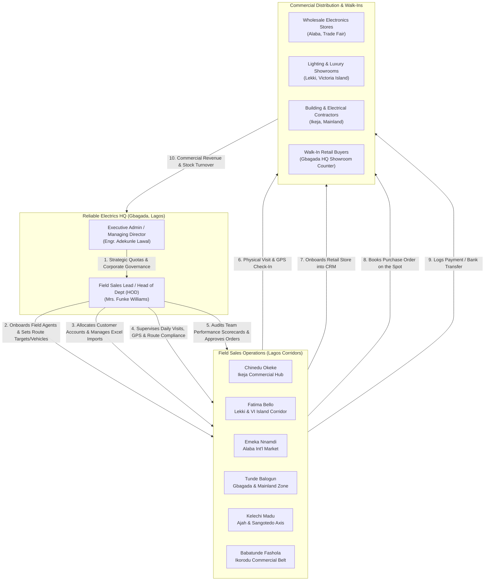

# Reliable Electrics Nigeria Limited — Enterprise CRM
## Stakeholder Role & Demo Execution Guide

> **Application Overview**: Enterprise Field Sales & Commercial Distribution CRM built for **Reliable Electrics Nigeria Limited** (Phase 1, 32B Oguntona Crescent, Gbagada, Lagos). The application manages field executive onboarding, retail customer onboarding by field agents, date-by-date daily activity auditing, wholesale product catalog, purchase orders, printable waybills, payment collections, walk-in counter sales, and manual customer spreadsheet imports.

---

## 1. Quick Access & User Login Credentials

| Parameter | Value |
| :--- | :--- |
| **Live Railway URL** | [https://crm-web-production-a3173e81.up.railway.app](https://crm-web-production-a3173e81.up.railway.app) |
| **Authentication Screen** | Standard Corporate Credentials Portal (`/login`) |
| **Universal Password** | `password` (for all seeded demo and production accounts) |

> [!NOTE]
> **Clean Enterprise Login Screen**: The demo preset tabs and capability switcher have been removed from the live sign-in page to maintain a secure, production-grade enterprise interface. To sign in as any stakeholder below, enter their **Work Email Address** and the universal password **`password`**.

### Complete Stakeholders & User Accounts Directory

| Stakeholder Persona | Full Name | Work Email Address | Password | Code / Ref | Assigned Territory / Operational Scope |
| :--- | :--- | :--- | :--- | :--- | :--- |
| **Executive Admin (MD)** | Engr. Adekunle Lawal | `admin@reliableelectrics.ng` | `password` | `HQ-ADM-01` | Headquarters — Lagos State Operations (Full Executive Access) |
| **Field Sales Lead (HOD)** | Mrs. Funke Williams | `lead@reliableelectrics.ng` | `password` | `REL-HOD-01` | Greater Lagos Commercial Operations (Department Head) |
| **Field Executive (Ikeja)** | Chinedu Okeke | `chinedu@reliableelectrics.ng` | `password` | `REL-FE-101` | Ikeja, Alausa & Oregun Commercial Hub |
| **Field Executive (Island)**| Fatima Bello | `fatima@reliableelectrics.ng` | `password` | `REL-FE-102` | Lekki Phase 1, Victoria Island & Ikoyi Corridor |
| **Field Executive (Alaba)** | Emeka Nnamdi | `emeka@reliableelectrics.ng` | `password` | `REL-FE-103` | Alaba International Market & Trade Fair Complex |
| **Field Executive (Mainland)**| Tunde Balogun | `tunde@reliableelectrics.ng` | `password` | `REL-FE-104` | Gbagada, Ogudu, Anthony & Shomolu Zone |
| **Field Executive (Ajah)** | Kelechi Madu | `kelechi@reliableelectrics.ng` | `password` | `REL-FE-999` | Ajah & Sangotedo Axis |
| **Field Executive (Ikorodu)**| Babatunde Fashola | `babatunde.fashola@reliableelectrics.ng` | `password` | `REL-FE-777` | Ikorodu Commercial Belt & Hardware Markets |

> [!IMPORTANT]
> **Head of Sales Department (HOD) — Quick Login & Core Capabilities**:
> - **Login Email**: `lead@reliableelectrics.ng` | **Password**: `password`
> - **What the Head of Sales Department Can Do**:
>   1. **Supervise Field Executives**: Real-time command dashboard showing live visit compliance, customer onboarding velocity, and revenue attainment vs quota across all Lagos territories.
>   2. **Onboard New Field Sales Representatives (`/agents/create`)**: Directly recruit new agents into the department. Set assigned territory, allocated company vehicle (Motorbike/Sedan/Van), daily visit quota, and revenue targets.
>   3. **Reassign Territories & Manage Quotas (`/agents/{id}`)**: Update rep profiles, reassign sales corridors, and adjust monthly benchmarks.
>   4. **Bulk Excel/CSV Customer Import (`/customers/import`)**: Upload manually prepared customer spreadsheets with smart column mapping, auto-deduplication, and attach customer accounts to specific field sales reps.
>   5. **Field Sales Rep Territory Allocation & Removal (`/customers/{customer}`)**: Attach unassigned customers to any rep or remove reps to return customers to the central HQ pool.
>   6. **Instant Walk-In Counter Sales (`/orders/walk-in`)**: Process spot orders for walk-in retail buyers at the central office with immediate payment collection and counter receipt generation.
>   7. **Date-by-Date Field Activity & Route Audit (`/activities/daily`)**: Inspect every rep's daily movements, live satellite GPS coordinates, auto-resolved physical street landmarks, and meeting discussion notes.
>   8. **Commercial Order Approvals & Waybills (`/orders`)**: Inspect sales orders booked by reps, approve orders (`Pending Approval` → `Approved` → `Dispatched`), and view printable warehouse delivery waybills.
>   9. **Team Audit Reports & CSV Export (`/activities/report`)**: Compare agent performance scorecards and export CSV logs for executive reviews.

---

## 2. Stakeholder Matrix & Responsibilities



---

## 3. Stakeholder 1: Executive Management / Admin

### Primary Persona
* **Name**: Engr. Adekunle Lawal
* **Role**: Managing Director & National Distribution Head
* **Email**: `admin@reliableelectrics.ng`
* **Password**: `password`
* **Access Level**: Full Administrative Rights (System-wide visibility)

### Core Objectives
1. Drive commercial distribution revenue across Lagos state commercial hubs.
2. Monitor real-time performance and quota pacing of field sales executives.
3. Audit daily field movements date-by-date to ensure field accountability.
4. Maintain credit risk governance on wholesale and retail distributor accounts.
5. Control inventory pricing (Wholesale vs Retail) and dispatch logistics.
6. Oversee customer territory assignments, unassigned HQ customer pools, and walk-in cash flows.

### Step-by-Step Demo Actions for Admin

#### Action 1: Executive Dashboard Analysis
* **Route**: `/dashboard`
* **What to inspect**:
  - **KPI Cards**: Month-to-date sales revenue (₦), quota attainment percentage, total active field agents, registered commercial stores, and pending orders awaiting dispatch.
  - **Revenue Target Gauge**: Target vs Realized revenue bar with variance indicator.
  - **Territory Distribution Chart**: Breakdown of retail network density across Ikeja, Alaba, Lekki, and Mainland.
  - **Leaderboard**: Top-performing field executives ranked by revenue and store onboarding pace.
  - **Live Audit Stream**: Real-time log of customer visits, orders booked, and payments confirmed.

#### Action 2: Date-by-Date Field Activity Tracker
* **Route**: `/activities/daily`
* **What to inspect**:
  - Click on the **Date Picker** and select today's date or previous dates.
  - Notice the summary cards automatically recalculate for that specific date: total visits conducted, orders booked, payments collected, and new stores onboarded.
  - Review the **Agent Summary Table**: Shows what every individual agent did on that day.
  - Expand any agent card to see the detailed audit feed: exact time of check-in, customer visited, visit purpose, visit notes, and clickable **GPS coordinates** (e.g. `6.5956, 3.3512`) that link directly to Google Maps for location verification.

#### Action 3: Bulk Customer Excel / CSV Spreadsheet Import
* **Route**: `/customers/import`
* **How to demo**:
  1. Click **Customers** in navigation, then click the **"Import Excel / CSV"** button in the header.
  2. Click **Download Sample CSV Template** (`/customers/template/download`) to inspect the standardized columns (*Company Name, Contact Person, Phone, Category, Territory, Address, Assigned Agent Code*).
  3. Drag and drop or browse to select your customer spreadsheet (`.csv` or `.xlsx`).
  4. Optionally select a **Default Field Sales Rep** to automatically assign all rows in the file to that representative, or leave blank to place them into the **Unassigned (HQ Pool)**.
  5. Click **Process Bulk Customer Import**. The system parses the file, deduplicates existing stores by customer code, and displays a summary notification (*"Spreadsheet imported successfully! 2 created, 0 updated"*).

#### Action 4: Field Sales Rep Territory Allocation & Removal
* **Route**: `/customers` and `/customers/{customer}`
* **How to demo**:
  1. On `/customers`, notice the **Field Rep** filter has an **"Unassigned (HQ Pool)"** option to view unallocated customers.
  2. Select multiple customers using the checkboxes and use the **Bulk Assign Selected Customers** dropdown to attach them to a field executive in one action.
  3. Click on any customer profile to view the dedicated **Field Sales Rep Territory Allocation** card:
     - Select a new rep from the dropdown and click **Save Assignment**.
     - Or click **Remove Rep** to detach the customer and move them back to the central HQ pool.

#### Action 5: Walk-In Customer 1-Click Counter Sale
* **Route**: `/orders/walk-in`
* **How to demo**:
  1. Click **Orders** in navigation, then click the orange **"Walk-in Customer Sale"** button.
  2. Enter the customer's name (e.g., `Alhaji Musa Kabir`) and phone number (`08031234567`).
  3. Add product line items (e.g., `50W LED Commercial Floodlight IP66`, quantity `5`).
  4. Select the payment method (`Direct Bank Transfer`, `POS Terminal`, or `Cash`) and enter the payment reference (e.g., `GTB/TRF/COUNTER/8821`).
  5. Click **Complete Walk-in Sale**. The customer is instantly registered, the order is marked `Confirmed`, the payment is recorded in full, and an official printable Waybill / Receipt is generated immediately.

#### Action 6: Sales Orders & Printable Waybill Generation
* **Route**: `/orders`
* **How to demo**:
  1. View the complete order register with status badges (`Pending Approval`, `Approved`, `Dispatched`, `Delivered`).
  2. Click on any order to view order line items.
  3. Click **Print Waybill / Delivery Note** — opens a formatted, print-ready document with company letterhead (**Reliable Electrics Nigeria Limited, Phase 1, 32B Oguntona Crescent, Gbagada, Lagos**), customer delivery address, line item breakdown, warehouse dispatch officer signature line, and customer acceptance signature line.

---

## 4. Stakeholder 2: Field Sales Lead / Head of Department (HOD)

### Primary Persona
* **Name**: Mrs. Funke Williams
* **Role**: Head of Field Sales & Department Lead
* **Email**: `lead@reliableelectrics.ng`
* **Password**: `password`
* **Access Level**: Field Operations Management & Team Supervision

### Core Objectives
1. Supervise field sales executives across all Lagos commercial corridors (Ikeja, Alaba, Lekki, Mainland, Ajah, Ikorodu).
2. Onboard new field sales executives into the team, assigning territories, revenue quotas, visit targets, and company motorbikes/vehicles.
3. Manage customer imports, allocate dealer accounts to field reps, and adjust territory boundaries.
4. Monitor daily agent performance, visit logs, and GPS route compliance date-by-date.
5. Audit team performance scorecards, completion rates, and customer onboarding velocity.
6. Approve and dispatch field sales orders, process walk-in buyers, and assist field agents with key accounts.

### Step-by-Step Demo Actions for Field Sales Lead (HOD)

#### Action 1: Team Leadership Dashboard
* **Route**: `/dashboard` (logged in as `Mrs. Funke Williams`)
* **What to inspect**:
  - Banner: *"Reliable Electrics Nigeria Limited • Department of Field Sales & Distribution"*.
  - Department field metrics: Active field reps, monthly new customer onboarding count, today's team visit total, month-to-date sales orders, and collections.
  - **Live Field Agent Leaderboard**: Real-time table displaying today's visit compliance vs daily target for each agent, monthly store onboards, and revenue attainment percentage.
  - Direct 1-click management shortcuts: **Date-by-Date Tracker**, **Onboard Agent**, **Import Customers**, and **Team Reports**.

#### Action 2: Onboard a New Field Sales Executive
* **Route**: `/agents/create`
* **How to demo**:
  1. Click **Onboard Agent** on the leadership dashboard or navigation menu.
  2. Enter new field executive details (e.g., `Babatunde Fashola`, `babatunde.fashola@reliableelectrics.ng`, territory: `Ikorodu Commercial Belt`, vehicle: `Company Motorbike (Bajaj Boxer)`, monthly quota: `₦5,000,000`).
  3. Click **Complete Field Executive Onboarding**. The system registers the account and redirects to the agent's performance profile.

#### Action 3: Inspect Individual Field Agent Scorecard
* **Route**: `/agents/{agent}` (e.g. click on `Chinedu Okeke`)
* **What to inspect**:
  - Individual agent scorecard: Today's visits count, daily compliance %, monthly revenue vs target, and stores onboarded.
  - Recent GPS Check-in history with exact time and physical street address.
  - Full list of stores onboarded by this agent and their order history.
  - Click **Edit Profile** to update the agent's assigned territory, targets, or vehicle.

---

## 5. Stakeholder 3: Field Sales Executives

### Primary Personas
* **Chinedu Okeke** (`chinedu@reliableelectrics.ng` | `password`) — Ikeja, Alausa & Oregun Commercial Hub
* **Fatima Bello** (`fatima@reliableelectrics.ng` | `password`) — Lekki Phase 1, Victoria Island & Ikoyi Corridor
* **Emeka Nnamdi** (`emeka@reliableelectrics.ng` | `password`) — Alaba International Market & Trade Fair Complex
* **Tunde Balogun** (`tunde@reliableelectrics.ng` | `password`) — Gbagada, Ogudu, Anthony & Shomolu Zone
* **Kelechi Madu** (`kelechi@reliableelectrics.ng` | `password`) — Ajah & Sangotedo Axis
* **Babatunde Fashola** (`babatunde.fashola@reliableelectrics.ng` | `password`) — Ikorodu Commercial Belt

### Core Objectives
1. Conduct scheduled daily field visits to electrical shops, showrooms, and building sites.
2. Scout and onboard new retail electrical dealers and electrical contractors.
3. Capture exact GPS location during visits to prove physical field presence.
4. Take commercial restock orders on the spot from shop owners.
5. Collect and log customer invoice payments and bank transfers.
6. Achieve monthly revenue and onboarding targets.

### Step-by-Step Demo Actions for Field Agents

#### Action 1: Field Agent Mobile Dashboard
* **Route**: `/dashboard` (logged in as an agent, e.g. `Chinedu Okeke`)
* **What to inspect**:
  - Tailored field view: displays the agent's specific territory (`Ikeja, Alausa & Oregun`), assigned agent code (`REL-FE-101`), monthly sales target progress, today's visit tally, and active customers.
  - On mobile screens, the sticky bottom navigation bar provides 1-tap shortcuts to **Home**, **Daily Log**, **Check-In**, **Customers**, and **Orders**.

#### Action 2: Field Visit & GPS Check-In
* **Route**: `/activities/check-in`
* **How to demo**:
  1. Click the blue **Check-In** button on the dashboard or bottom bar.
  2. Select the customer being visited from the dropdown.
  3. Select **Activity Type**: *Routine Sales Visit*, *Order Booking*, *Cold Call*, or *Debt Collection*.
  4. Click **Capture Current Location (GPS)** to auto-detect and stamp physical storefront coordinates.
  5. Enter visit notes and click **Submit Field Check-In**.

#### Action 3: Customer Onboarding in the Field
* **Route**: `/customers/create`
* **How to demo**:
  1. Click **+ Onboard Customer** in the customers section.
  2. Enter store name, contact person, phone number, category, territory, address, credit limit, and payment terms.
  3. Click **Complete Customer Onboarding**. The store is saved with an onboarding record, linked to this field agent, and immediately eligible to receive sales orders.

#### Action 4: Taking an Instant Purchase Order
* **Route**: `/orders/create`
* **How to demo**:
  1. Click **+ Create Order** from the orders screen or customer page.
  2. Select the customer and add items (e.g., 50W Floodlights, 16-Way Distribution Boards).
  3. Observe automatic total, wholesale pricing, and VAT computation.
  4. Click **Submit Sales Order**. Order confirmation is created with status `Confirmed`.

---

## 6. End-to-End Demo Script (10-Minute Walkthrough)

To present this application to an audience, follow this sequential 9-step narrative:

```
Step 1: Open Live Application (https://crm-web-production-a3173e81.up.railway.app/login)
        ↳ Explain the secure corporate sign-in screen (Work Email + Password).

Step 2: Log in as Executive Admin (admin@reliableelectrics.ng / password)
        ↳ Showcase Executive Dashboard: Lagos revenue target attainment, top field agents, territory chart.

Step 3: Switch to Field Sales Lead / HOD (lead@reliableelectrics.ng / password)
        ↳ Showcase Field Operations & Team Leadership Dashboard.
        ↳ Demonstrate onboarding a new field sales executive (/agents/create) with territory, quota, and vehicle.

Step 4: Demonstrate Manual Customer Excel/CSV Bulk Import (/customers/import)
        ↳ Download the official CSV template (/customers/template/download).
        ↳ Upload customer spreadsheet with auto-column matching and territory allocation.

Step 5: Demonstrate Field Sales Rep Territory Allocation (/customers)
        ↳ Filter by "Unassigned (HQ Pool)" and bulk-assign stores to reps.
        ↳ Open customer profile (/customers/{id}) and demonstrate "Save Assignment" and "Remove Rep".

Step 6: Demonstrate Instant Walk-In Customer Sale (/orders/walk-in)
        ↳ Process an instant spot sale for a counter buyer with immediate bank transfer collection.
        ↳ View the auto-generated receipt and printable delivery waybill.

Step 7: Switch to Field Executive (chinedu@reliableelectrics.ng / password)
        ↳ Demonstrate mobile-responsive UI with bottom navigation bar.
        ↳ Perform a live Check-In (/activities/check-in) with GPS location capture.
        ↳ Book a wholesale purchase order on customer premises (/orders/create).

Step 8: Open Date-by-Date Daily Tracker (/activities/daily)
        ↳ Pick today's date.
        ↳ Show how leadership audits what each field agent did today (visits, orders, check-in GPS).

Step 9: Demonstrate Team Reports & CSV Export (/activities/report)
        ↳ Filter agent activities and download the complete audit trail as a CSV file.
```

---
*Reliable Electrics Nigeria Limited • Phase 1, 32B Oguntona Crescent, Gbagada, Lagos • Enterprise CRM*